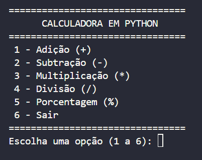
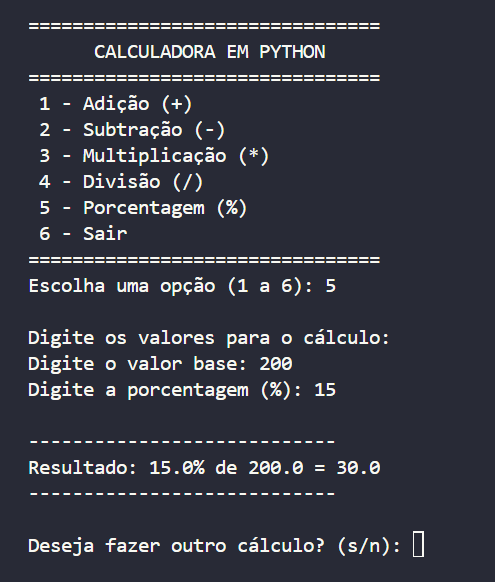
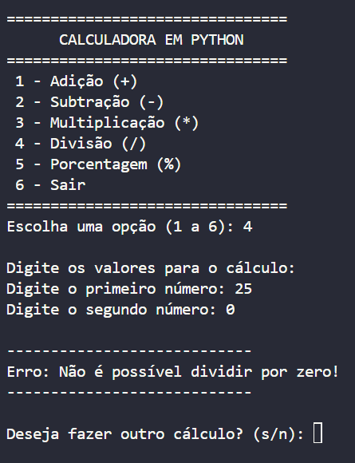
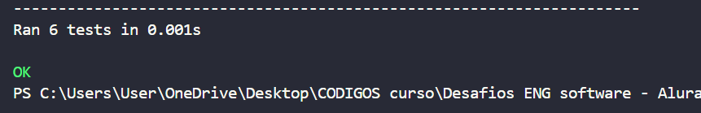
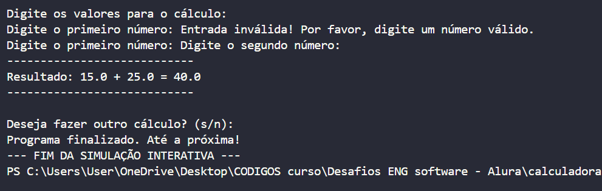

# 🧮 Calculadora em Python: evolução com o Google Antigravity

Projeto do **Desafio 2: Evoluindo sua primeira aplicação com o Google Antigravity**. Partindo da calculadora de terminal do Desafio 1 (adição, subtração, multiplicação e divisão), usei o Google Antigravity para entender o código existente, adicionar o **cálculo de porcentagem** e **testar** se tudo continua funcionando.

## O que mudou em relação ao Desafio 1

- Nova opção **5 - Porcentagem (%)** no menu
- A opção de sair passou a ser a **6 - Sair**
- Nova função `calcular_porcentagem(valor, percentual)`
- Mensagens de entrada específicas para a porcentagem ("valor base" e "porcentagem")
- Novos arquivos de testes automáticos

## Estrutura do projeto

```
calculadora-python-porcentagem/
├── calculadora.py            # Programa principal com o menu e as operações
├── test_calculadora.py       # Testes unitários das operações
├── test_fluxo_interativo.py  # Simulação de uma sessão de uso do menu
├── README.md
└── imagens/                  # Prints usados neste README
```

## Como executar

1. Instale o [Python 3](https://www.python.org/downloads/)
2. Baixe os arquivos deste repositório
3. No terminal, dentro da pasta do projeto, execute:

```bash
python calculadora.py
```

### Como rodar os testes

```bash
python test_calculadora.py
python test_fluxo_interativo.py
```

## Exemplos de uso

**Menu com a nova opção**



**Cálculo de porcentagem (15% de 200)**



**Operação antiga continua funcionando (divisão por zero)**



## Como o desafio foi feito

### 1. Explorando o projeto

Pedi ao Antigravity que analisasse o código e explicasse a estrutura. O código está em um único arquivo, dividido em quatro partes:

| Parte | Funções | O que faz |
|---|---|---|
| Operações matemáticas | `somar`, `subtrair`, `multiplicar`, `dividir` | Recebem dois valores e devolvem o resultado com `return`. A divisão confere se o divisor é zero antes de calcular. |
| Interface e entrada | `exibir_menu`, `obter_numero` | Mostram o menu e leem os números. O `try / except` evita que o programa trave se o usuário digitar letras. |
| Função principal | `main` | Controla o fluxo: laço `while True`, validação da opção, decisão com `if / elif` e pergunta se o usuário quer continuar. |
| Ponto de entrada | `if __name__ == "__main__":` | Garante que o menu só abra quando o arquivo é executado diretamente, e não quando as funções são importadas em outro arquivo (como nos testes). |

> Essa análise foi feita sobre a versão original, em que a opção 5 era "Sair". Na versão atual, a 5 é Porcentagem e a 6 é Sair.

### 2. Adicionando a porcentagem

Pedi ao Antigravity que implementasse o cálculo de porcentagem sem alterar as operações existentes. As alterações foram:

- **Nova função** `calcular_porcentagem(valor, percentual)`, que usa a fórmula `(valor * percentual) / 100`. Exemplo: 15% de 200 = `(200 * 15) / 100` = 30.0.
- **Menu atualizado:** foi incluída a linha `5 - Porcentagem (%)` e "Sair" passou a ser a opção 6.
- **Validações ajustadas em `main()`:** a saída agora confere `opcao == "6"` e as opções válidas vão de 1 a 5.
- **Mensagens específicas:** na opção 5, o programa pergunta pelo "valor base" e pela "porcentagem (%)".
- **Novo bloco `elif opcao == "5"`**, que chama a função e mostra o resultado, por exemplo: `Resultado: 15.0% de 200.0 = 30.0`.

### 3. Testando a aplicação

Pedi ao Antigravity que testasse a aplicação e verificasse se a nova funcionalidade funciona sem quebrar as anteriores. Ele criou dois arquivos de teste:

**`test_calculadora.py`** (testes unitários com o `unittest`, que já vem com o Python):

| Teste | Exemplos | Resultado esperado |
|---|---|---|
| Soma | 10 + 5, -2 + 3, 2.5 + 3.1 | 15, 1, 5.6 |
| Subtração | 10 - 4, 5 - 10 | 6, -5 |
| Multiplicação | 7 * 8, -3 * 4, 5 * 0 | 56, -12, 0 |
| Divisão comum | 10 / 2, 7 / 2 | 5.0, 3.5 |
| Divisão por zero | 10 / 0 | Mensagem de erro amigável |
| Porcentagem | 15% de 200, 50% de 80, 0% de 50 | 30.0, 40.0, 0.0 |

Resultado da execução: **6 testes, todos aprovados**.



**`test_fluxo_interativo.py`** simula uma sessão de uso do menu, sem precisar digitar nada.



Os testes das quatro operações antigas continuarem passando mostra que a nova funcionalidade não quebrou nada do que já existia.

## Prompts utilizados

1. *"Tenho um projeto de calculadora em Python que realiza as quatro operações matemáticas básicas. Estou começando a aprender programação e quero entender como os arquivos e as funções estão organizados. Analise o projeto e explique sua estrutura de maneira simples."*
2. *"Agora quero adicionar uma funcionalidade para calcular porcentagens. Implemente essa operação mantendo as funcionalidades existentes e explique quais alterações foram realizadas no código."*
3. *"Agora me ajude a testar a aplicação e verificar os resultados."*

## Tecnologias

- Python 3
- Google Antigravity (exploração, implementação e testes)
